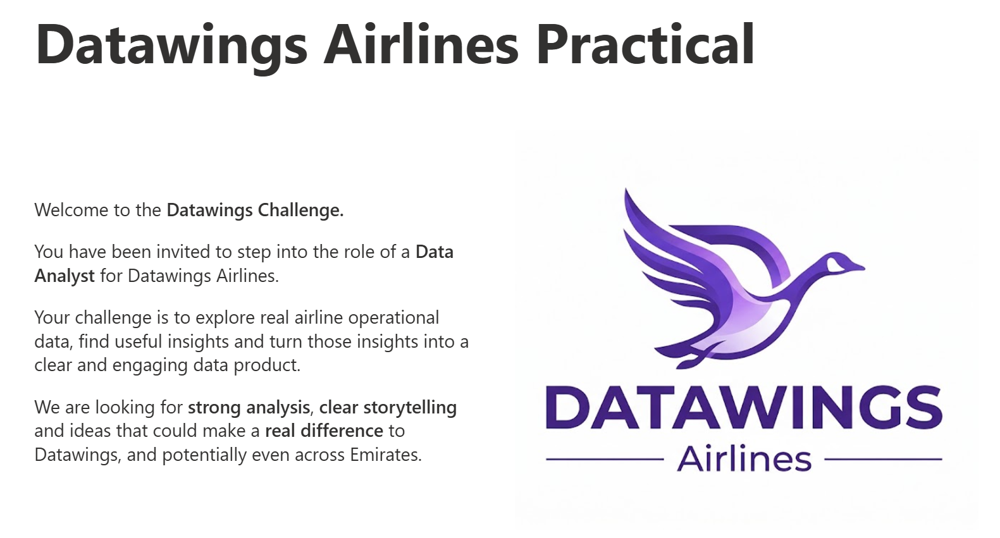
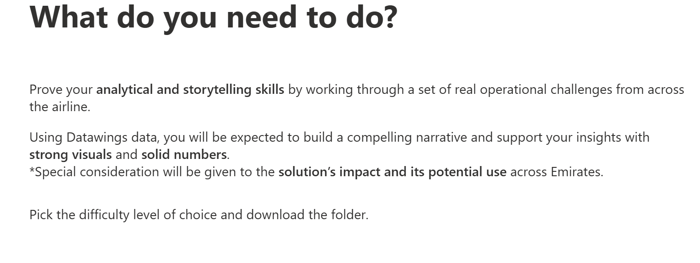
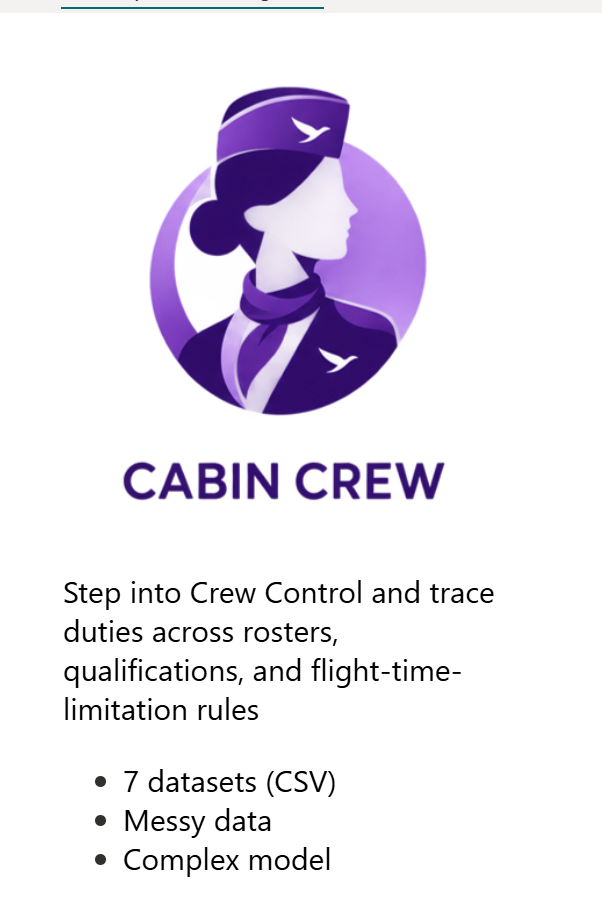
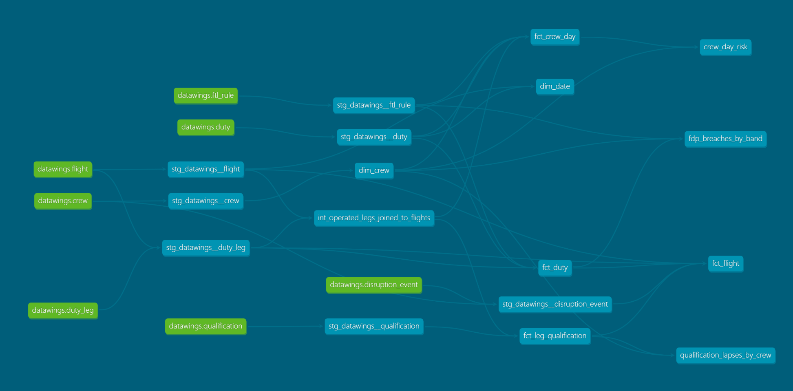

A data product for the **Datawings Airlines practical**, **Cabin Crew** track: 7 messy CSVs
go in as source data. A full E2E ingestion pipeline with Python, dbt, and a streamlit board that answers the following question:
**are our crew legal and rested to fly, and if not, is it a planning problem or a disruption problem?**

<p>
  
  
</p>

## Architecture (ELT)

```
data/raw/*.csv ─ingest─▶ raw ─dbt─▶ staging ─▶ intermediate ─▶ marts ─▶ Streamlit board
                (E + L)  as delivered  typed,     reusable         star schema +
                                       cleaned,   joins            board tables
                                       DQ-flagged
                                          ▲
                              ref.rank_map, ref.qual_requirement (seeds)
```

- **Ingestion** (`uv run ingest`) lands every CSV in the `raw` schema as-is, all text, plus
  `_source_file` and `_loaded_at`. 
- **dbt** is the T only, in the standard [dbt project layout](https://docs.getdbt.com/best-practices/how-we-structure/1-guide-overview):
  raw is declared as the `datawings` source; `staging` (views) types and cleans it 1:1;
  `intermediate` (ephemeral) holds reusable joins; `marts` (tables) is what consumers read.
- **Seeds** are only reference data that we own and version in git (`rank_map`, `qual_requirement`).
  The FTL rulebook is external (regulator / policy), so it's ingested like any other source.
- **Tests**: 98 dbt tests. Source tests that fail on known data issues warn; everything else is an
  error, so a new problem in the source breaks the build.

## The board

`uv run streamlit run app/board.py`: a Streamlit "Crew Control: FTL risk" board on the dbt marts.

- **KPI row**: legs without a valid qualification, FDP breaches, crew over cumulative limits, crew near a limit today.
- **1 · Legality**: legs flown on lapsed qualifications by type, and who, for how long.
- **2 · Duty length**: FDP breach rate by report-time band, rostered-over vs ran-over-on-the-day.
- **3 · Fatigue**: crew over the 7-day / 28-day limits per day, and the closest-to-limit list for the chosen date.
- Filters for fleet, crew group and "roster as of" date.


### The marts

| Table | Grain | What it answers |
| --- | --- | --- |
| `dim_crew` | crew member | rank, fleet, base, seniority band |
| `dim_date` | calendar date | conformed date dimension |
| `fct_flight` | flight leg | crew counts, legality, FDP and disruption rolled up per flight |
| `fct_duty` | flying duty | FDP limit (band, sectors, augmentation) and breach, planned vs actual |
| `fct_leg_qualification` | leg × required qualification | was this person legal on this leg, on this day? |
| `fct_crew_day` | crew member × date (periodic snapshot) | rolling 7-day duty, 28-day block hours, days off, headroom |
| `fdp_breaches_by_band` | band × fleet × crew group | board section 2 (counts, so filters re-sum) |
| `qualification_lapses_by_crew` | crew × qualification type | board section 1 |
| `crew_day_risk` | crew member × date | board section 3, with the near-limit rule as dbt vars |


### Lineage

<p>
  
</p>

## How to run
```powershell
uv sync
uv run pre-commit install        # lint Python + SQL on every commit (once)

uv run ingest                    # land raw -> bronze (rerun when source files change)
cd dbt
uv run dbt build                 # seeds + staging + marts + tests, in dependency order
uv run dbt docs generate; uv run dbt docs serve   # lineage graph in the browser
cd ..
uv run pytest
uv run streamlit run app/board.py
```

Always run dbt from inside `dbt/`. DuckDB allows one writer at a time. If ingest or dbt says the
database is locked, close the notebook or board holding it.

## Layout

```
data/raw/                         source CSVs, untouched (gitignored)
data/datawings.duckdb             the warehouse (gitignored, rebuild any time)
src/datawings/                    ingest.py (raw -> bronze), db.py, load.py, config.py
dbt/
  models/staging/datawings/       stg_datawings__<table>.sql, sources + tests     -> schema staging
  models/intermediate/crew_control/  int_*.sql (ephemeral)
  models/marts/crew_control/      dim_*, fct_*, board tables                       -> schema marts
  seeds/                          rank_map, qual_requirement                        -> schema ref
  macros/naming.sql               custom schema names as-is (no "main_" prefix)
  tests/generic/                  matches_pattern test
app/board.py                      Streamlit board
scripts/diff_tables.py            diff two warehouse tables on a key
docs/                             data model, findings log, images
tests/                            pytest parity checks
```

## Data

The source data and data dictionary are not included in this repo.

